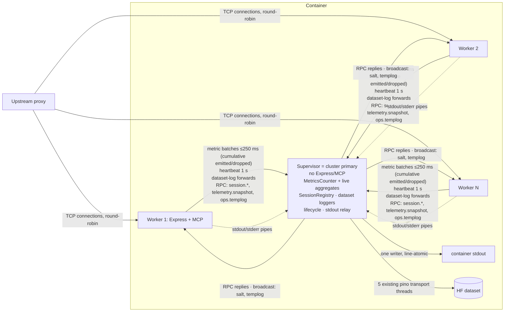

# HF MCP Server — Multicore Plan (supervisor + workers)

Status: proposal. Written fresh from the code at `8787cea`; does not build on `multicore-plan-2026-10-13.md`.
Review: two independent review rounds (Claude Opus 5.5, GPT-6-astra) plus local spikes (`/tmp/cluster-spike`, WSL2, 32 cores, Node 24.2).

## 1. Summary

We will run `/mcp` on N `node:cluster` workers behind one **supervisor**, the cluster primary. The supervisor serves no HTTP. It owns three things:

1. The **authoritative live statistics**: workers forward their metric calls in batches; the supervisor replays them into the one real `MetricsCounter`.
2. The **legacy session registry**: workers look up sessions by RPC. Session IDs are unchanged on the wire.
3. **Worker lifecycle**: start, restart, drain, stdout relay and the load-distribution view.

`MCP_WORKERS` unset keeps today's single process unchanged. That is also the rollback, done by changing an env var. Identity (OAuth / PAT / anonymous) improvements run as a parallel track so they don't blur the parity check for multicore.

Spike evidence:

| Experiment | Result |
|---|---|
| Throughput, CPU-bound handler, 1/2/4/8 workers | 694 / 1,384 / 2,583 / 4,619 req/s (1.0× / 2.0× / 3.7× / 6.7×) |
| Distribution, 200 connections, 4 workers | 24 / 24 / 25 / 27 % (`SCHED_RR` default) |
| Distribution, 2 keep-alive connections, 4 workers | 50 / 50 / 0 / 0 % → with `maxRequestsPerSocket=100` and a well-behaved agent: 25 % each, 0 errors (clients that ignore `Connection: close` get 503s) |
| IPC telemetry, 20k events/s batched at 250 ms | Primary ELU 1.9 % (`json`) vs 2.8 % (`advanced`) |
| Session-lookup RPC + 20k events/s, 4 workers | p50 0.14 ms, p99 0.83–0.93 ms, max ≤ 3.7 ms at 1k–10k RPC/s; primary ELU 5–10 % |
| Shared stdout, 10 KB lines | 26–2,359 corrupt lines per 12k when inherited; **0** when relayed by the primary line by line |

## 1a. Production facts (from `hf spaces info/variables/secrets/logs` and the logging dataset, 13 Oct 2026)

| Fact | Value | Consequence |
|---|---|---|
| Hosting | Space `evalstate/hf-mcp-server`; Docker SDK; Space Dockerfile is `FROM ghcr.io/evalstate/hf-mcp-server:latest`; `app_port: 3000` | Deploy = push image + Space restart. **Pin an image tag per phase** so a code rollback is a one-line Space Dockerfile change |
| Hardware | `cpu-upgrade`: **8 vCPU, 32 GB**; 1 replica | Supervisor + up to **7 workers**; ramp 2 → 4 → 7. Memory is not the constraint |
| `ANALYTICS_MODE` | `true` | Legacy session registry (§5) is **mandatory** before N > 1 |
| `USER_CONFIG_API` | set (external settings API) | `apiMetrics` is shown on the dashboard → included in forwarded events; `McpApiClient` has no cache, so no state |
| `LOG_LEVEL` | `warn` | Operational stdout volume is low |
| Stdout format | `pino-pretty`, **multi-line** records (dataset configured ⇒ `logger.ts:37-55` path) | Relay must keep records intact (§6.7) |
| Node process | pid 11 under `/bin/sh` (PID 1) | Confirms SIGTERM isn't forwarded → every deploy hard-kills node and loses buffered dataset logs (up to 30 min for 4 streams). Fixed in Phase 0b |
| Dataset logging | `LOGGING_BATCH_SIZE=10000`, `LOGGING_FLUSH_INTERVAL=1800000` (30 min), dataset `evalstate/hf-mcp-logs` | See measured volume below |
| Measured log volume (last ~34 h, 600 commits) | **~18 commits/h**, **~93k entries/h**. `sessions/` (system events) is ~95 % of it: about 1.1M entries / 830 MB on 13 Oct by 12:30 UTC, a 10k-entry commit every ~6 min (~28 entries/s). `queries/`, `gradio/`, `skills/`, `logs/` commit only on the 30-min timer | Per-worker loggers at N=7 would mean ~80 commits/h (4.4×) and N× entries held for up to 30 min in memory. Central upload keeps ~18/h, and the IPC cost of ~28 entries/s is negligible ⇒ **centralise in Phase 2** (§7) |
| `TEMPLOG_MAX` | secret set | Templog is in use → supervisor-owned countdown (§6.4) |
| `DEFINITION_TAGS_TEST` | not set (`DEFINITION_DIGESTS_TEST` and `SEARCH_ENABLES_FETCH` are set but **not read by any code**: stale) | The definition-tags test routes are off in prod → not supported in cluster mode (§6.4). Clean up the stale vars |
| Secrets present | `LOGGING_HF_TOKEN`, `METRICS_PAGE_PASSWORD`, `ALLOW_INTERNAL_ADDRESS_HOSTS`, `TEMPLOG_MAX` | Workers inherit env as today |

### Live traffic baseline (`/api/transport-metrics`, two snapshots 62 s apart, 13 Oct 12:36 UTC, uptime 48.5 h)

| Metric | Value |
|---|---|
| Request rate | **~104 req/s** now; 1 h avg ~105/s (6,286/min); lifetime avg ~95/s; 16.5M requests in 48.5 h |
| Era split (window) | legacy ~56/s, modern ~44/s (lifetime 9.44M legacy / 6.36M modern) |
| Method mix (req/s) | ping 26.1 · tools/list 16.9 · server/discover 14.9 · resources/list 10.9 · initialize 7.2 · notifications/initialized 6.8 · resources/templates/list 2.6 · all tools/call ≈ 1.5 |
| Avg response times | ping 6 ms, server/discover 13 ms, initialize 15 ms, tools/list 20 ms, resources/list 22 ms; tool calls 40 ms – 9 s (I/O-bound: Hub/Gradio) |
| Protocol versions | legacy 2025-11-25 42 %, modern 2026-07-28 41 %, legacy 2025-06-18 17 %, long tail |
| Auth (connections) | authenticated 8.69M (61 %), anonymous 6.60M (36 %), 401 0.49M (3 %) |
| Distinct (48 h) | 100,578 users, 68,640 IPs, 2,047 client name@version |
| Legacy sessions | created 1.23M, deleted 0.73M, **live in Map 493k** (shown as `connections.active`), `resumedFailed` 42.7k (~0.24/s) |
| Errors | 1.23M expected (4xx), 568 unexpected (5xx) |
| Dashboard payload | **1.55 MB per poll** (clients 1.27 MB, methods 0.39 MB), polled every 3 s per open tab |
| External responsiveness | TTFB on `/mcp` matches `huggingface.co` itself (p50 110 ms, p90 122 ms vs 110/113 ms). No visible event-loop lag at the current load |

What this means for the plan:
- **The single process is not saturated today.** Multicore buys headroom for spikes and growth, plus crash isolation. It is not a fix for current latency. The Phase 3 ramp is gated on measured ELU: if 2 workers keep each worker's ELU well below 0.5, we stop at 2–4 rather than 7.
- **IPC load is small.** Telemetry is ~100 req/s × ~10 calls ≈ 1k events/s, against the 20k/s that was spiked. Session RPCs are ≤ ~56/s (legacy only).
- **The legacy session Map is an OOM time bomb in today's single process.** It is independent of multicore and fixed first (Phase 0d, below).
- **The dashboard snapshot is big.** The supervisor serializes the snapshot once, caches the JSON string for 1 s (shared by all viewers), and workers pass the string through untouched (`res.type('json').send(str)`), with no parse/re-stringify. Splitting the `clients` table into its own paginated endpoint is a later UI improvement.
- **The load harness uses this mix** (§10) at 1× (~100 req/s) and 10× (~1,000 req/s).

### Legacy session Map capacity (measured)

- **Entry cost:** ~1.31 KB of heap per `SessionMetadata`, using realistic `clientCapabilities`/`clientInfo` objects parsed from JSON, a UUID, two Dates, an IP and a userHash.
- **Today:** 493k entries ≈ **650 MB** of heap.
- **Growth:** 1.23M created − 0.73M deleted in 48.5 h, a net **~244k/day ≈ 320 MB/day**. This window covers Sun–Tue; weekday rates may be higher.
- **Ceiling:** the default V8 heap limit is ~4.3–4.5 GB, so the process **OOMs at ~2.8–3.1M entries**. A local run with only the Map in the heap aborted at 3.0–3.1M entries (heap 4.1 GB) with *"Ineffective mark-compacts near heap limit"*. Just before death, a 1.46 s stop-the-world mark-compact ran and mutator utilization fell to ~17–26%. The V8 `Map` hard cap (8,388,608 entries) is never the binding limit.
- **Degradation starts earlier.** Forced full GC was 0.24 s at 500k entries and 2.75 s at 2M. Concurrent marking hides most of that, but as the heap fills, GCs become more frequent and longer.
- **Timeline from a restart:**

  | Uptime | Sessions (approx.) | Heap (sessions) | State |
  |---|---|---|---|
  | 2 d (now) | 0.5M | 0.65 GB | fine |
  | ~6 d (longest observed run, 22–28 Sep, ended by a release) | 1.5M | 2 GB | probably OK; GC cost rising |
  | ~8 d | ~2M | 2.6 GB | latency spikes likely |
  | **~10–12 d** (sooner if weekday growth is higher) | 2.8–3.1M | 3.7–4.1 GB | **OOM crash** |

  The current process started 11 Oct 12:05 UTC. Without a deploy, expect GC degradation around **18–19 Oct** and OOM around **21–23 Oct**.
- **It hasn't bitten yet only by luck.** Releases every 1–6 days have reset the Map. Restarts on 22 Sep, 28/29 Sep, 1 Oct, 2 Oct and 5 Oct match `chore: release` tags within ~10 min. The 1 Oct 08:53 restart matches the `HF_SKILLS_DIR` variable change that day. The 11 Oct 12:06 restart matches neither; confirm whether it was manual. The Spaces swap also overlaps old and new containers (old process committed at 12:06:22, new started 12:05:37).
- In the cluster design the registry moves into the supervisor. An unbounded registry would then OOM the supervisor and take all workers down, and its GC pauses would stall session RPCs. **A bounded registry is therefore a prerequisite for Phase 2**, not an option.

Still unknown: CPU/ELU of the process (no in-process metric yet), the Spaces proxy's keep-alive behaviour and `X-Forwarded-For` hop count, and the Spaces stop grace period. Phase 0c measures all of them in single-process mode before any clustering.

## 2. Current state that matters (verified)

| State | Location | Under cluster | Plan |
|---|---|---|---|
| `MetricsCounter`: unique users (sha256(username)), unique IPs, token hashes per client, rolling windows, method/era/version/client stats | `shared/transport-metrics.ts`; created in `base-transport.ts:87`; accessed via the `track*` wrappers (`base-transport.ts:118-185`) and directly as `this.metrics.*` in the transport | Fragmented; unique counts can't be merged | Replay in supervisor (§4) |
| `updateActiveConnections(size)`, `trackSessionCreated/Deleted` | `stateless-http-transport.ts:1555,1627`; `transport-metrics.ts:911` | Last writer wins | Owned by the session registry |
| Live aggregates: `apiMetrics`, `gradioMetrics`, `skillsLiveMetrics`, hf-fs, dynamic-space, definition-tag stats, gradio cache hit/miss | `utils/api-metrics.ts:62`, `gradio-metrics.ts:133`, `skills-live-metrics.ts:183`, `hf-fs-live-metrics.ts`, `dynamic-space-live-metrics.ts`, `definition-tags/stats.ts` | Fragmented | Forward to supervisor (§4) |
| **Legacy analytics sessions** (`ANALYTICS_MODE=true`): issue ID, 404 for unknown IDs, DELETE, metadata (`clientInfo` for the denylist + attribution, protocol version, capabilities, auth flag, IP) | `analyticsSessions` Map, ~9 sync reads (`:1074,1095,1140,1163,1216,1295,1340,1494,1549`). `clientInfo` is added *after* creation (`:1188` → `:1310/1640`) | **(N-1)/N of resumes would 404** | Supervisor registry over RPC (§5) |
| Ops state: definition-tags salt + stats reset, templog countdown | `definition-tags/policy.ts`, `web-server.ts:334-353`, transport `:1645-1670` | Per worker | Supervisor-owned / broadcast (§6) |
| Dataset logs: up to 5 pino transport threads per process, each an `HfDatasetLogger` (one commit per `LOGGING_BATCH_SIZE` entries, or per interval of ≥300 s in prod); per-process `mcpServerSessionId` | `logger.ts`, `query-logger.ts:199`, `skill-event-logger.ts`, `hf-dataset-transport.ts` | Works per worker (unique filenames); N× threads; interval commits up to N× | §7 |
| Stdout: `pino-pretty` transport thread when the dataset is configured (`logger.ts:37-55`), else `pino.destination(1)` | | Interleaving | Relay via supervisor (§7) |
| Caches: gradio, definition-tag memo, skills catalog (refreshes in background), `packages/mcp` caches | various | Per worker is fine (a miss is slower but correct) | Show catalog version/cache size per worker |
| Startup: `listen()` runs before `/mcp` routes are registered | `application.ts:84-99` | A restarted worker would accept live sockets early | Listen after routes (§6) |
| Container: `/bin/sh ./start.sh` is PID 1, node is a child; `shutdown()` never exits | `Dockerfile:71`, `start.sh`, `run-application.ts` | SIGTERM probably never reaches node today | Phase 0 fix (§9) |

Already safe: the metrics-page auth cookie (stateless HMAC) and `fetchHfWhoami` (no cache).

## 3. Architecture



Design choices:

- **Why `node:cluster`.** It has built-in port sharing with round-robin, crash isolation and separate heaps, and it is the idiomatic Node approach. We rejected `worker_threads`: the sockets would have to be distributed by hand, and one crash takes down the whole process. Multiple containers are a later step, because dashboard aggregation across replicas is a distributed problem.
- **The supervisor is deliberately thin.** Its module graph is `transport-metrics.ts`, the live aggregators, the registry and a plain stdout writer. No Express, MCP SDK or Gradio. It is a single point of failure, but the blast radius matches today: if it dies, workers exit on `disconnect` and the container restarts.
- **Same classes, two wirings.** `MetricsCounter`, the aggregators and `SessionRegistry` run in-process in single mode and inside the supervisor in cluster mode. Only the thin "local vs IPC" adapters differ.
- **IPC uses the default `json` serialization**, which measured cheaper than `advanced`.

## 4. Telemetry: one counter, replayed calls

### 4.1 Write path

`BaseTransport.metrics` gets the type `MetricsRecorder`, derived from the counter rather than hand-written:

```ts
// telemetry/events.ts
type Recordable = 'trackRequest' | 'trackMethod' | 'trackProtocolRequest' | /* … every void track* used by transports */;
export type MetricsRecorder = Pick<MetricsCounter, Recordable>;
export type MetricsCall = { [K in Recordable]: { m: K; a: Parameters<MetricsCounter[K]> } }[Recordable];
export type LiveEvent =
  | { k: 'skills'; a: SkillLiveEventInput } | { k: 'hfFs'; a: HfFsQueryTelemetry }
  | { k: 'dynSpace'; a: [op: string, ok: boolean, stage?: string] } | { k: 'gradio'; a: ['ok' | 'fail', string] | ['schemaFormat', 'array' | 'object'] }
  | { k: 'api'; a: [hasToken: boolean, status: number] } | { k: 'defTags'; a: DefTagsStatEvent }
  | { k: 'inflight'; a: [client: ClientKey, delta: 1 | -1] };
export type TelemetryEvent = MetricsCall | LiveEvent;
```

- A `MetricsRecorder` implementation is either the real counter (single mode) or a `ForwardingRecorder`, a `Proxy`/class that pushes `{m, a}` (worker mode). The supervisor runs `counter[m](...a)`.
- Three signatures are adapted so their arguments are plain and safe to send. These changes are behaviour-preserving and land in Phase 1:
  - `trackAuthenticatedUser` returns `void`. The worker computes `userHash` with the existing `hashUserIdentity()`.
  - `trackError(status, {type, message})` takes plain data. `type` keeps today's `constructor.name`, and the message is not truncated.
  - `trackClientAuth(tokenHash)` takes a hash. The worker hashes with the existing sha256, so raw tokens never cross IPC.
- **Same-process data policy.** IPs and usernames-as-hashes already appear in session metadata and logs. IPC is a local pipe inside the container, not a privacy boundary, so no new hashing scheme is added.
- **Processing time, not event time.** The supervisor applies events on arrival. Counts are exact either way. Rates and last-seen values lag by ≤ 250 ms, which is disclosed in the UI tooltip. `RollingWindowCounter` is single-bucket and already approximate. A settable clock would be wrong for out-of-order workers.
- **Gauges.** Session-owned client connections (legacy initialize → DELETE) move to the session registry and survive worker restarts. Request-owned in-flight counts (modern exchanges) are `inflight ±1` events, kept in a per-worker tally that is discarded when that worker exits. No reversal bookkeeping is needed elsewhere.
- Each live-metric module keeps its `record*()` export, which now calls `telemetry.emit(...)`. The aggregation logic moves into a class owned by `TelemetryAggregator`. `gradioMetrics.schemaFetchError()` stays worker-local: it only de-duplicates log lines and isn't a metric.

### 4.2 Delivery and integrity counters

- The worker flushes every 250 ms or 1,000 events, with one `process.send` in flight at a time. Under backpressure it keeps accumulating up to ~8 MB, then drops events and counts them. **Any drop is an integrity alarm.**
- Every batch carries the worker's cumulative `emitted` and `dropped`. The supervisor keeps `applied` per `worker.id`; cluster never reuses IDs within one supervisor. For live workers the invariant `applied + dropped == emitted` holds after every batch, so no barrier protocol is needed.
- **Crash:** the dashboard marks the dead worker's last-reported totals as final, with "unknown tail ≤ one flush window". It does not claim an exact loss. Totals from retired workers stay in the counter.
- **Graceful stop:** the worker sends its final batch, then `{t:'drained', emitted}`. The supervisor confirms `applied == emitted` before treating the worker as cleanly retired. Loss is zero.

**What we claim:** exact counts across workers while they are alive or stopped gracefully; after a crash, a bounded and visible tail is lost.

### 4.3 Read path

- `WebServer` gets a `TelemetrySource` injected from `run-application.ts`. Local mode reads the in-process aggregator; worker mode makes the RPC `telemetry.snapshot(query)` with a 2 s timeout.
- On timeout the route returns **503**. No route may fall back to worker-local numbers. This covers `/api/transport-metrics`, `/api/skills-metrics`, `/api/definition-tags` and `/api/cluster`.
- Cache ratios are recomputed from summed hits and misses.

## 5. Legacy sessions: authoritative registry over RPC

The current Map moves into `SessionRegistry` (`sessions/session-registry.ts`), which sits behind an async `SessionStore`:

```ts
interface SessionStore {
  create(meta: SessionMeta): Promise<void>;                 // meta includes clientInfo (extracted before creation)
  getAndTouch(id: string): Promise<SessionMeta | undefined>; // one call per request; updates lastActivity/requestCount
  delete(id: string): Promise<SessionMeta | undefined>;     // atomic; second DELETE → undefined → 404
  list(opts: { limit: number }): Promise<{ total: number; sessions: SessionMeta[] }>; // capped
}
```

- **Phase 1 (single process):**
  - Introduce `LocalSessionStore` (Map) and refactor the transport to call `getAndTouch` **once per request** and pass the result down, replacing the ~9 synchronous reads.
  - Move `clientInfo` extraction before `create`.
  - Registry events (create/delete) drive `sessions.created/deleted`, active sessions and session-owned client gauges.
- **Phase 2 (cluster):** `RpcSessionStore`. Every call is an RPC; there is **no worker cache**, so 404s and request counts stay exact across workers. Measured p99 is < 1 ms. A cache is added only if the dashboard's RPC p99 justifies it.
- Failure policy is **fail closed** and explicit:

  | Case | Response |
  |---|---|
  | `create` fails or times out (500 ms) | `initialize` returns 503 (the client retries), so a 404 on the next call isn't guaranteed |
  | `getAndTouch` times out | 503 with `Retry-After: 1` (distinct from 404) |
  | Unknown ID | 404 |
  | Missing ID | 400 |
  | `ANALYTICS_MODE` off | No issuance; DELETE returns 405 (unchanged) |

  Counter `sessionRpcFailures` on the dashboard is a rollback trigger. (The denylist relies on `clientInfo`, so fail-open was rejected.)
- **Behaviour:** a worker restart keeps sessions, which is better than today. A supervisor or container restart loses them, as every deploy does now.
- `/api/sessions` is capped (`limit`, default 500) and returns `total`, so the unbounded registry can't stall the supervisor.
- Sessions still never expire. An idle TTL is a separate, optional change.
- Rejected: HMAC-signed self-describing IDs. They change the wire format, expose client metadata in headers, and make revocation lossy.

## 6. Supervisor, workers, lifecycle

### 6.1 Files

```
packages/app/src/server/
  streamableHttp.ts            # read MCP_WORKERS; primary → import('./cluster/supervisor.js'), else import('./run-application.js')
  cluster/protocol.ts          # message unions, PROTOCOL_VERSION, timeouts
  cluster/supervisor.ts        # fork/restart/drain, stdout relay, RPC + broadcast dispatch, worker table
  cluster/worker-channel.ts    # batch sender, rpc(), onBroadcast(), heartbeat
  telemetry/{events,aggregator,forwarding-recorder,source}.ts
  sessions/{session-registry,session-store}.ts
```

### 6.2 Protocol (`protocol.ts`)

```ts
type WorkerToSupervisor =
  | { t: 'batch'; emitted: number; dropped: number; events: TelemetryEvent[];
      logs: { stream: 'Query' | 'System' | 'Gradio' | 'Skill' | 'Logs'; time: number; obj: object; msg: string }[]; logsDropped: number }
  | { t: 'heartbeat'; hb: WorkerHeartbeat }
  | { t: 'rpc'; id: number; method: RpcMethod; params: unknown }
  | { t: 'ready' } | { t: 'drained'; emitted: number };
type SupervisorToWorker =
  | { t: 'rpc-result'; id: number; ok: true; value: unknown } | { t: 'rpc-result'; id: number; ok: false; error: string }
  | { t: 'broadcast'; topic: 'salt' | 'templog'; value: unknown } | { t: 'shutdown'; deadlineMs: number };
type RpcMethod = 'config.get' | 'session.create' | 'session.getAndTouch' | 'session.delete' | 'session.list'
  | 'telemetry.snapshot' | 'ops.templog';
```

### 6.3 Worker boot

1. Subscribe to broadcasts.
2. Call `config.get`: protocol version, salt, templog state, shared `mcpServerSessionId`.
3. Build the app and register *all* routes.
4. `listen()`.
5. Send `ready`.

The listen-after-routes reorder also lands in single mode (Phase 1). A protocol-version mismatch makes the worker exit.

### 6.4 Ops state

- **Definition-tags test mode** (`DEFINITION_TAGS_TEST=true`: runtime salt and stats reset) is off in production. In cluster mode the supervisor logs a warning and the test routes return 404. This test-only feature needs single-process mode, which drops `ops.setSalt` and `ops.resetDefTagStats` from the protocol. Definition-tag *stats* are still aggregated centrally.
- **Templog:** the countdown lives in the supervisor. A worker only sends the redacted resume-failure details when the broadcast flag is on, and the supervisor prints up to the remaining count.

### 6.5 Restart

- Exponential backoff from 1 s to 30 s.
- If there are more than 5 exits in 60 s, the supervisor exits non-zero so the orchestrator restarts the container.

### 6.6 Shutdown (SIGTERM/SIGINT reach the supervisor; workers ignore signals and act only on `shutdown`)

The budget is `SHUTDOWN_GRACE_MS`, default 25 s, set below the orchestrator's grace period.

1. **Supervisor** sends `shutdown`.
2. **Each worker:**
   - runs `server.close()` and `closeIdleConnections()`;
   - waits for in-flight requests until the deadline minus 5 s;
   - flushes telemetry and dataset-log forwards, and sends `drained`;
   - exits 0.
3. **Supervisor** waits for every worker to exit and for each stdout pipe to reach EOF. It then closes its dataset loggers, which flushes the final upload from each transport thread within the remaining deadline, and exits.
4. A hard kill happens at the deadline.

### 6.7 Stdout relay

- Fork with `silent: true` and use `readline` per pipe, with a maximum line length of 64 KB (longer lines are split).
- Production uses multi-line `pino-pretty` records, and lines from different workers could interleave inside a record. In worker mode, `pino-pretty` therefore runs with `singleLine: true` plus a `w<id>` prefix (via `messageFormat`), so each record is one line and attributable to its worker. Volume is low (`LOG_LEVEL=warn`).
- A single writer handles all output. On `write()` returning `false`, the supervisor pauses every worker's readline until `drain`. Workers then block on their own stdout exactly as a single process does today. IPC is a separate channel and keeps flowing.

### 6.8 Debugging aid

`MCP_WORKER_HEADER=true` adds `X-MCP-Worker: <id>`. Tests use it to *prove* that requests crossed workers.

## 7. Logging: answer to "is a single supervisor enough?"

- **Operational stdout:** the supervisor must relay it (§6.7). This is required for correctness, since lines were corrupted in the spike.
- **Dataset logs: centralise in the supervisor (Phase 2), reusing today's code.** Production data (§1a) settles it:

  | | Per-worker loggers (N=7) | Central (supervisor) |
  |---|---|---|
  | Commits/h | ~80 (timer flushes × N) | ~18 (unchanged) |
  | Transport threads | 35 | 5 |
  | Logs at risk on a worker crash | up to 30 min of that worker's entries | ≤ 250 ms batch |
  | Supervisor cost | none | ~28 entries/s over IPC (spike: 20k/s ≈ 2 % ELU) |

  How it works, with the least new code:
  - **Worker:** the `queryLogger` / `systemLogger` / `gradioLogger` / `skillLogger` instances, plus the main logger's dataset target, are replaced by a forwarder with the same call shape. It sends `{ stream, time, obj, msg }` in the telemetry batch channel. There is a separate bounded queue: it drops the oldest entries and counts the drops, and logs are always dropped before telemetry.
  - **Supervisor:** creates the **same** pino loggers as today (`createQueryLogger()` etc., including the `hf-dataset-transport.js` worker-thread targets) and calls `logger.info(obj, msg)`, preserving `time` by passing the worker's timestamp through pino's `timestamp` option. Redaction, serialization and uploads happen in the transport threads, so the supervisor's event loop (and the session RPCs) aren't blocked by a 10k-entry, ~7 MB upload.
  - Result: same files, folders, fields and commit cadence as today. One `mcpServerSessionId` per deploy, plus a new `workerId` field.

  Phase-1 fixes to `HfDatasetLogger`, applied in both modes:
  - per-instance signal handlers are removed, and the owner closes the loggers;
  - `flush()` returns the upload promise;
  - the timeout aborts the upload rather than racing it;
  - upload failures and drops are counted;
  - `maxBufferSize` is raised above `LOGGING_BATCH_SIZE`. Today both are 10,000, so entries arriving during a slow upload of a full buffer are silently shifted out.
- **Is a single supervisor enough? Yes.** At ~93k entries/h it is two orders of magnitude below the measured IPC headroom. Phase 0b (`exec node` + graceful close) removes the largest *current* loss: up to 30 min of buffered entries for four streams on every deploy. A more robust pipeline (spool file → Vector/OTel → object storage) is justified only if logs become business-critical. If the commit count or size becomes a problem, the next lever is to pack the 30-min timer flushes of all streams into one `uploadFiles` commit (18/h → ~12/h).

## 8. Load-distribution view (dashboard)

### 8.1 Heartbeat

Each worker sends a heartbeat every 1 s containing:
- id and pid
- uptime
- requests: total and last minute
- in-flight count
- open sockets and requests per socket (shows keep-alive imbalance)
- ELU, from `performance.eventLoopUtilization`
- CPU %
- RSS and heap
- `emitted` and `dropped`
- skills catalog version
- gradio cache size

### 8.2 Supervisor self-report

The supervisor reports on itself:
- ELU
- events applied per second
- session RPC p50/p99
- registry size
- restarts
- desired vs live workers
- integrity counters: drops, `sessionRpcFailures`, crash tails

### 8.3 UI

- Add `GET /api/cluster` and a `WorkersCard.tsx` with:
  - a per-worker table
  - a request-share bar
  - badges for: stale heartbeat (> 3 s), ELU > 0.9, any integrity counter > 0, and imbalance (a worker's 5-minute share > 1.5× its fair share)
- The card also works in single mode, showing one row.

## 9. Phases, gates, rollback

| Phase | Ships | Behaviour change | Gate |
|---|---|---|---|
| **0a** | Library bumps (separate PR): `@modelcontextprotocol/server`/`client` 2.3.1, `node` 2.1.1, `express` 5.3.0, `@huggingface/hub` 2.17.x, Node 24.x latest, dev tools | None intended | Full tests + smoke v1/v2 |
| **0b** | `exec node` in `start.sh`; `shutdown()` calls `process.exit` after `app.stop()` and logger close, with a timeout | Clean SIGTERM | `docker stop` test shows exit within grace and final dataset upload |
| **0d (urgent, single PR)** | Bound the legacy session Map:<br>- **idle TTL**, `SESSION_IDLE_TTL_HOURS`, off by default; set it from the resume-gap histogram (24 h suggested);<br>- **hard cap**, `SESSION_MAX`, default 1,000,000;<br>- **slimmer entries** (deferred: it changes the capabilities recorded in dataset logs): store `clientCapabilities` as a compact summary, since full objects are only used for logs, and drop the unused `capabilities` field.<br>Mechanics:<br>- touch does `delete` + `set`, so Map order is by last activity;<br>- a sweep every TTL/12 (10 s – 5 min) expires idle entries from the front in 25k chunks, O(expired); the cap evicts from the front on session creation, O(1);<br>- TTL removals count into `sessions.expired` and cap removals into `sessions.evicted`; no per-session dataset logs.<br>Add a histogram of resume gaps (now − lastActivity at touch) to choose the TTL from data | Sessions idle > 24 h get a 404 and re-initialize; spec-allowed. Today's restarts already drop every session every 1–6 days | Heap/registry size flat after 24 h (~≤ 0.8 GB at today's creation rate; less with slimmer entries); `resumedFailed` rate not materially above baseline (~0.24/s) |
| **0c** | Single-process instrumentation on the dashboard: ELU, CPU, RSS, event-loop delay; **connection stats** (new sockets/s, requests per socket, open sockets); **`X-Forwarded-For` hop-count histogram** (counts only); SIGTERM-received / exit timestamps in the log. Remove the stale Space vars | Additive | 48 h of prod baseline answers §11: req/s and CPU headroom; Spaces proxy keep-alive shape (decides whether `MCP_MAX_REQUESTS_PER_SOCKET` is needed); hop count (sets `TRUST_PROXY`); stop grace period (sets `SHUTDOWN_GRACE_MS`) |
| **1** | All shared-code refactors, local wiring only: `MetricsRecorder` (3 adapted signatures), live-metric emit/aggregator, `TelemetrySource`, `SessionStore` + single lookup per request, registry-owned session gauges, listen-after-routes, `HfDatasetLogger` fixes, dataset-logger seam (the four event loggers and the main dataset target are obtained through one `getDatasetLogger(stream)`, local implementation = today's pino), `/api/cluster` (1 row), capped `/api/sessions`, pre-serialized 1 s snapshot cache | None intended | Golden tests; 24 h prod parity vs 0c (requests, uniques, sessions, 404 rate, dataset volume) |
| **2** | New files only + entry switch: supervisor, worker channel, forwarding recorder, RPC store/source, dataset-log forwarder + supervisor-side loggers, stdout relay, load harness | Only when `MCP_WORKERS` is set | Harness green; prod `MCP_WORKERS=1` for 24–48 h: numbers track the Phase-1 run-rate, integrity counters 0, session RPC p99 < 2 ms, dataset still ~18 commits/h with the same entry volume, clean SIGTERM |
| **3** | `MCP_WORKERS=2` → `4` → `7` (8 vCPU: 7 workers + supervisor), ≥ 24 h per step | Load spread | Integrity 0; legacy 404 / `resumedFailed` and 5xx ≤ baseline; p99 ≤ baseline; supervisor ELU < 0.3; RSS < 80 % of limit; shares within bounds (else evaluate `MCP_MAX_REQUESTS_PER_SOCKET`, default off, only after confirming the upstream honours `Connection: close`) |

Rollback:
- **Phase 2/3:** `hf spaces variables delete evalstate/hf-mcp-server MCP_WORKERS` (or set it lower). Changing a variable restarts the Space. The single-process path is the exact Phase-1 code already proven in prod, because Phase 2 adds files only.
- **Phase 0/1 (code):** change the Space Dockerfile's `FROM ghcr.io/evalstate/hf-mcp-server:<tag>` back to the previous pinned tag. Stop using `:latest` from Phase 0 onward. No wire changes.
- **Immediate rollback triggers:** any unexplained integrity counter, session RPC failures, a rise in legacy 404s, memory pressure.

### Parallel track B: identity (requirement 4), independent of the multicore parity check

1. **Credential classification.** Extract `classifyCredential()` from `buildCredential` (`utils/hf-whoami.ts:205-254`), so that the tool and the metrics agree. Kinds:
   - `oauth`
   - `pat` (read / write / fine-grained)
   - `app`
   - `other` (`auth.type` is unrestricted)
   - `anonymous`
   - `unverified` (whoami unavailable)
   - `rejected` (401)
2. **Per-kind metrics.** Add requests and unique principals per kind × era (legacy/modern) and per client.
   - The user key stays `hashUserIdentity(username)` (log continuity). Apps and orgs are namespaced.
   - Per-kind uniques are labelled **not additive**, since one person can use OAuth and a PAT.
   - Anonymous traffic is shown as unique **addresses**, with a count of requests missing an address.
   - Add `authKind` to the query/system/skill dataset records.
3. **Flagged `TRUST_PROXY`** (hop count or CIDRs) for Express, using `req.ip` instead of the first `X-Forwarded-For`, which is spoofable today (`web-server.ts:65`, `base-transport.ts:197-212`). Shadow-compare old vs new unique-address counts for 24 h before switching.

Track B lands as normal single-process PRs. In cluster mode it automatically benefits from central aggregation, since the per-kind uniques are just more replayed recorder calls.

## 10. Proving it locally (synthetic load)

### 10.1 Harness (`scripts/load/`)

- **`mock-hub.ts`**
  - `whoami-v2` fixtures: OAuth, PAT, app, `hf_bad*` → 401, and an outage mode for `unverified`.
  - The minimal Hub endpoints that the selected tool calls need.
  - Requires two test-only, documented overrides: `HF_WHOAMI_URL` and a hub base URL.
- **`run-cluster-load.ts`** builds once, then starts the server with `MCP_WORKERS ∈ {unset, 1, 2, 4, 8}`, `ANALYTICS_MODE ∈ {true, false}` and `MCP_WORKER_HEADER=true`. It uses autocannon plus a custom keep-alive `http.Agent` client.

### 10.2 Scenarios

- **Legacy sessions:** initialize → initialized → tools/list → tools/call → DELETE. Each step uses a new connection, and the run asserts that steps were served by different workers (via the header). Also: duplicate DELETE (one 200, one 404) and reuse after DELETE (404).
- **Modern traffic:** server/discover, tools/list, tools/call.
- **Production mix profile** (from §1a): ping 25 %, tools/list 16 %, server/discover 14 %, resources/list 10 %, initialize 7 %, initialized 7 %, templates/list 3 %, tools/call 1.5 % (mock Hub), rest spread. Legacy:modern ≈ 56:44; authenticated:anonymous:401 ≈ 61:36:3. Run at ~100 req/s (1×) and ~1,000 req/s (10×) for 10 min each.
- **Population:**
  - 300 OAuth users
  - 300 PAT users
  - 50 users with both
  - 20 app tokens
  - 200 anonymous addresses
  - invalid tokens
  - whoami outage
- **Connection shapes:** 200 short connections; 2–8 long keep-alive connections, with and without `MCP_MAX_REQUESTS_PER_SOCKET`.
- **Faults:**
  - `kill -9` on a worker mid-run
  - SIGTERM on the supervisor mid-run (drain)
  - SIGSTOP on the supervisor for 1 s (expect 503s with Retry-After, not 404s)
  - mock Hub returning 500 on uploads
- **Stdout:** real `pino-pretty` thread-stream path with the dataset configured; 0 corrupt lines.

### 10.3 Assertions

Read via `/api/*` after graceful drain:
- Counted `/mcp` POST/DELETE equals the number sent.
- Unique principals overall and per kind match the fixtures.
- `resumedFailed == 0`; response bodies are valid JSON-RPC.
- `applied + dropped == emitted`; drops == 0, except in the crash run, which shows a tail no larger than one flush window.
- Many-connection runs: every worker serves within fair share ± 5 percentage points, over 3 repeats.
- A throughput/p99 table for N = 1..8 is written to `scripts/load/report.md`.

### 10.4 Tests

- **CI:** a vitest integration test at N=2 that runs against `dist` (the test builds first). It covers cross-worker sessions, reconciliation and graceful shutdown.
- **Unit tests:**
  - The same event stream applied inline and replayed through a 4-way interleaved `ForwardingRecorder` gives identical counts and uniques in `formatMetricsForAPI`.
  - `SessionStore` contract tests run against both implementations.
  - `classifyCredential` is tested against sanitized real whoami fixtures.
  - Protocol guards are tested.

## 11. Open questions

Already answered from the Space: hardware (8 vCPU / 32 GB, 1 replica), `ANALYTICS_MODE=true`, logging config and volume (§1a).

Phase 0c instrumentation answers these:
1. CPU and ELU of the single process over a daily cycle. Request rate is known (~100 req/s, §1a); peak hours and in-process saturation are not.
2. The Spaces proxy's keep-alive shape: requests per socket, concurrent sockets, and whether it honours `Connection: close`. Test the last one with a short `MCP_MAX_REQUESTS_PER_SOCKET` canary only if imbalance appears.
3. `X-Forwarded-For` hop count in front of the Space (for `TRUST_PROXY`).
4. The Spaces stop grace period, measured from SIGTERM to kill once `exec node` lands.

For you to decide:
5. Under a supervisor stall, should legacy session lookups fail closed with 503 (proposed) or open?
6. Is it acceptable that the definition-tags test mode needs `MCP_WORKERS` unset?
